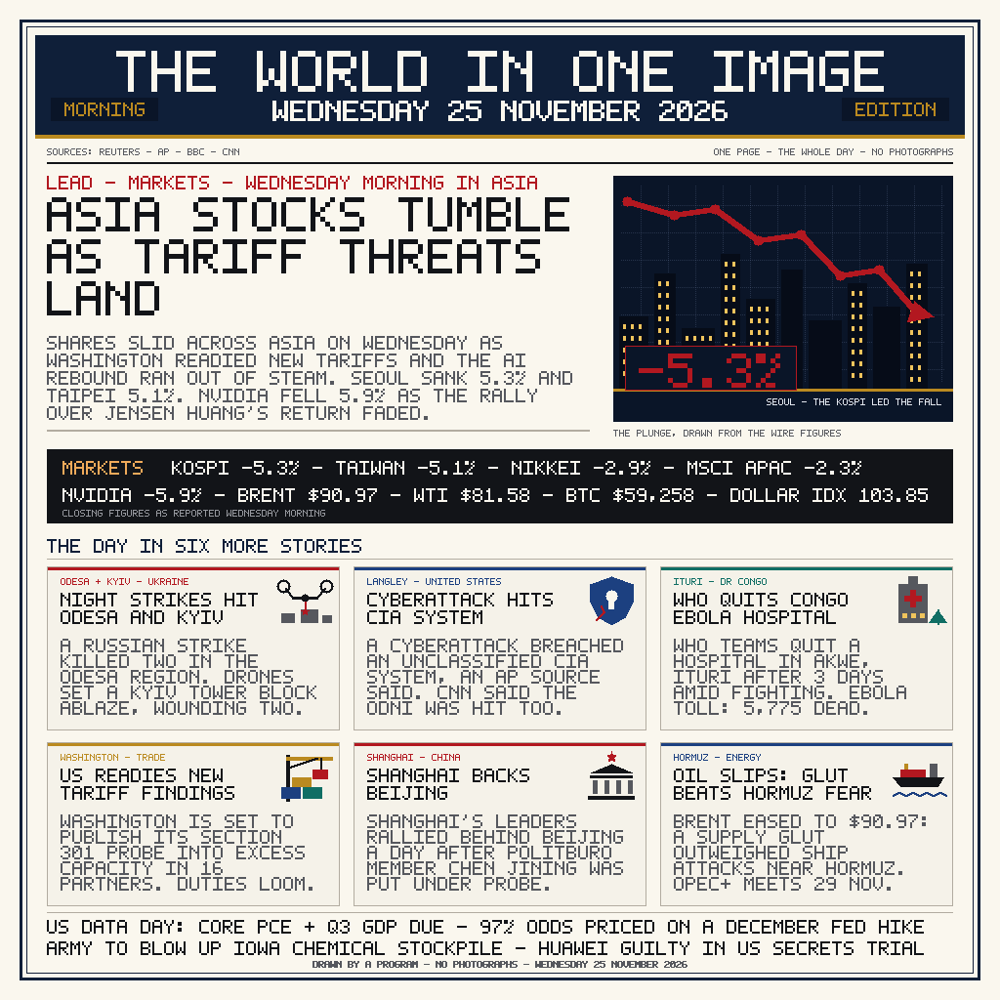

# the-world-in-one-image-20261125

[](https://make.fun/bounty/news-image-20261125?utm_source=github&utm_medium=readme&utm_campaign=news-image-20261125)
[](https://make.fun/bounty/news-image-20261125/leaderboard?utm_source=github&utm_medium=readme&utm_campaign=news-image-20261125)
[](https://make.fun/bounty/news-image-20261125?utm_source=github&utm_medium=readme&utm_campaign=news-image-20261125)



## About this entry

A single Node program (`main.ts`, standard library only — no packages, no
assets, no network) draws an entire newspaper front page in software and
writes it as one deterministic 1024×1024 PNG. The program contains its own
rasterizer (rectangles, lines, circles, ellipses, polygons, stars), a
hand-authored 5×7 bitmap font with word-wrap layout, drawn illustrations
(a night skyline under a plunging red index line for the lead story, and
one pictogram per panel), and its own PNG encoder. Running it twice
produces byte-identical output.

The design is a broadsheet "morning ledger": warm paper, a navy masthead
with gold rules, one lead story across the top, a black markets band, six
story panels and a two-line wire ticker along the bottom — deliberately
different from this account's white "extra edition" of 24 November, its
cream broadsheet of 21 November and its navy night poster of 22 November.

## The day's stories — Wednesday 25 November 2026

- **Lead — Markets:** Asia stocks tumble as tariff threats land. Shares
  slid across Asia on Wednesday morning as Washington readied new tariffs
  and the AI rebound fizzled: South Korea's Kospi fell 5.3%, Taiwan 5.1%,
  the Nikkei 2.9% and the MSCI Asia-Pacific index 2.3%; Nvidia fell 5.9%
  as the rally over Jensen Huang's return faded.
- **Odesa + Kyiv, Ukraine:** A Russian strike killed two people in the
  Odesa region, the governor said; drones set a Kyiv tower block ablaze,
  wounding two.
- **Langley, United States:** A cyberattack breached an unclassified CIA
  system, an AP source said; CNN reported the CIA and the ODNI were hit.
- **Ituri, DR Congo:** WHO teams quit a hospital in Akwe after sheltering
  three days from fighting, at the heart of an Ebola outbreak whose toll
  stands at 5,775 dead.
- **Washington — Trade:** The administration is set to publish its
  Section 301 probe into "excess industrial capacity" in 16 trading
  partners, China and the EU included; new duties are expected.
- **Shanghai, China:** Shanghai's leaders rallied behind Beijing a day
  after Politburo member Chen Jining was put under investigation.
- **Hormuz — Energy:** Brent eased to $90.97 as rising supply outweighed
  attacks on ships near the Strait of Hormuz; OPEC+ meets 29 November.
- **Ticker:** America's data day — core PCE and the second Q3 GDP reading
  are due, with traders pricing 97% odds of a December Fed hike · the US
  Army will detonate its Iowa chemical stockpile · a US jury found Huawei
  guilty in a trade-secrets trial.

## Run it

```sh
mkdir -p out && MAKEFUN_OUTPUT_DIR=out node main.ts
# writes out/entry.png — 1024×1024, byte-identical on every run
```

## License

MIT — see [LICENSE](LICENSE). Sources and per-story fact notes are in
[NOTES.md](NOTES.md).
